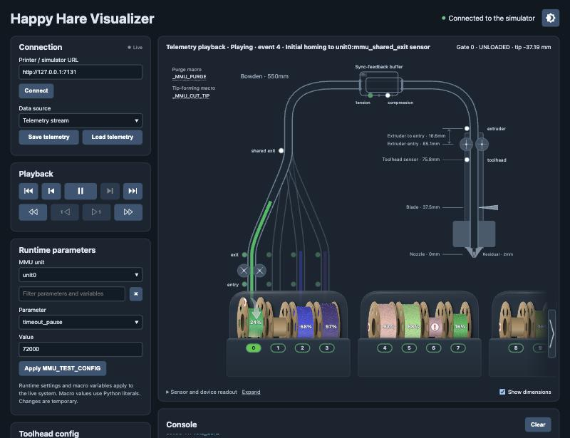

# Happy Hare viewer



A standalone, build-free web application that animates Happy Hare's filament movement. It is plain
ES modules, CSS and one `index.html`; it talks to a Moonraker-compatible API and has no dependency on
the simulator.

## Modules
| Module | Holds |
|---|---|
| `app.js` | Connection, data sources, playback state, the frame loop and the sidebar |
| `scene.js` | The main view: `createScene(host, hooks).render(view, settings)` draws one scene state. It reads no sidebar input and writes no control. The render is a sequence of named parts (`measure`, `rack`, `tips`, `sensors`, `gears`, `nozzle` and others) sharing one frame context |
| `controls.js`, `readout.js` | The playback controls; the macro names and the sensor and device chips |
| `telemetry-stream.js` | The stream transport: subscribe, acknowledge, and never replay a repeated batch |
| `telemetry.js`, `live-state.js`, `live-config.js`, `scene-state.js` | Telemetry replay and live status, both reduced to the same scene state |
| `playback.js`, `overlay.js`, `editor.js` | Pure helpers: step timing, geometry, labels, the idle sensor overlay, editor commands |
| `path-measure.js` | Length and point-at-length of the scene's paths, computed without the page |
| `unit-info.js` | What the footer under each unit shows, worked out from live printer objects |
| `unit-icons.js` | The vendor logos and climate glyphs, as SVG paths |
| `spool.js`, `buffer-view.js`, `spool-picker.js`, `toolhead-panel.js`, `console-log.js`, `chrome.js`, `simulator.js`, `util.js` | Spool and buffer drawing, side panels, the console, theme and tooltips, simulator calls, shared helpers |

Everything outside `app.js`, `scene.js` and the small DOM modules has no DOM access and is covered by the JS tests.

## Data sources
- **Live status subscription**: subscribes to Moonraker printer objects (`configfile`, `save_variables`, `mmu`, macros).
  Needs nothing from Happy Hare beyond `mmu.homing` and `mmu.config_changes`.
- **Telemetry stream**: follows the `server.mmu.telemetry.*` stream and overlays the latest sensor readings.
- **Loaded telemetry recording**: plays a saved recording (`.jsonl`) offline.

The parameter and Toolhead config editors send `MMU_TEST_CONFIG` / `SET_GCODE_VARIABLE` through
`printer.gcode.script`, so they work against a real printer and the simulator alike.

## The unit rack
Every MMU unit is drawn side by side on one rack under the Bowden exit, and a unit with many gates wraps into rows.
The rack slides so the selected spool stays under the exit (a virtual-selector unit centres on it), and a gate change
slides it along with the existing selection animation. Narrow arrows at the panel edges appear when part of a unit is
off screen; they scroll the rack by hand until the next gate selection.

## Simulator-only features
Profile switching and sensor toggles use `sim.viewer.*` RPCs that only
the simulator provides. The viewer probes for them once on connect and hides those controls elsewhere.

## Running it
- With the simulator: `make console` serves it at `http://127.0.0.1:7125/sim/viewer/` (or the address in the console
  banner if another port was selected); `--no-serve` turns the viewer and the web API off.
- On a printer: see "Hosting on a printer" below.
- Any other static host works if the page can reach a Moonraker URL (the host must be allowed by Moonraker's
  `cors_domains`).

## Hosting on a printer
From the Happy Hare directory on the printer:

```bash
./install.sh -w
```

This adds an nginx site of its own, beside Mainsail or Fluidd, and prints its address (the first free port from
8090, for example `http://<printer>:8090/`). It serves the `viewer/` folder and proxies `/websocket` and the
Moonraker API paths to Moonraker on port 7125, exactly as Mainsail's own site does, so the page and the API
share an origin and nothing needs adding to `cors_domains`. The step asks before using `sudo`, runs `nginx -t`
before reloading, and puts the old configuration back if nginx rejects it. Re-running it keeps the same port.
`./install.sh -u` removes the site along with Happy Hare. Updates need nothing extra: the files are in the
Happy Hare checkout, so the normal update refreshes them.

- nginx must already be installed (Mainsail and Fluidd images include it). If it is missing the step says so and
  changes nothing; install it with your system's package manager, or use any other static host as above.
- If the page shows a 403, nginx's user cannot read the folder, usually because the home directory is private.
  Allow it to be traversed with `chmod o+x ~`.
- The site exposes the same Moonraker API as Mainsail does on its port; Moonraker's own authorization rules apply.
- Another Moonraker port: `UPSTREAM_PORT=7126 ./install.sh -w`; another first port: `VISUALIZER_PORT=9000 ./install.sh -w`.

## Tests
`node --test viewer/*.test.mjs` (optional browser tests: `viewer/*.browser.mjs`, need Playwright).

## Using the live viewer

The diagram follows the console session, including commands typed at the terminal
or sent from the browser. It shows the MMU and extruder gears, a compressed Bowden
path, configured switches and encoder/buffer state. Animation is reconstructed
from Happy Hare source telemetry in `viewer/telemetry.js`; it never reads the
simulator's filament coordinates or stepper-observer hooks. This is a schematic
interpretation of commanded motion and sensor observations, not a melt simulation.
Most macro bodies retain the harness's recorded-only behavior described below.

The trace records MMU gear/extruder moves, MMU-owned G1 extrusion, cutter hooks,
toolchange markers, filament state changes and relevant configuration edits.
Selector motion and simulator-only macro fallbacks do not create animation steps. Logical movement records are published when each move completes, with start/end
states, actual travel and homing outcome. The viewer queues and interpolates them.
Acknowledged WebSocket batches preserve event order even when the simulator
delivers them after a command returns. Socket reader threads never enter the reactor. Pacing (`--pace`) makes
long moves easier to follow. Instant operations can finish before the browser's
next refresh, but their events remain available for replay.

**Previous**, **Next** and the timeline inspect captured state without rewinding
Happy Hare itself and stop automatic playback. **Play** animates the backlog and
then follows live events. While playing, that button becomes **Pause**, which
finishes the current step before stopping. **End, go live** skips the backlog.
**Show internal updates** reveals expandable diagnostic rows in Movement trace.
These retain their source sequence numbers but are skipped by playback, the
previous/next buttons and the timeline. Updates observed during a move are shown
for inspection without applying them to the preceding step.

Playback uses the resolved feed speed in the source telemetry, independently of
console pacing. Bowden time compression is off by default: the path is drawn
shorter but takes distance/speed time. The optional compression checkbox shortens
fast transfers in proportion to the drawing. The trace shows feed speed and marks
compressed transfers. Very short moves have a 120 ms visibility minimum;
retractions that release purge have a 650 ms minimum so the drop remains visible.
Acceleration is recorded but is not reproduced by the linear playback.

Parking is schematic: the sign of `gate_parking_distance` selects a small fixed
gap before or after the drawn exit endstop. Encoder-homed gates park a small
fixed distance before the encoder; encoder homing records `homing_overshoot_mm` for the displayed overshoot.
Final visual positioning obeys active presence sensors: clear sensors limit
forward travel, and triggered sensors limit withdrawal unless a detached fragment
explains the reading. Contradictory moves hold at the last safe position and show
a **!** with sensor details. Disabled sensors provide no constraint.

A gate exit or shared exit sensor that the unit neither homes nor preloads on is the exception: Happy Hare
does not say where it is, so it is drawn at a nominal place, lights from its reading alone, and neither
limits the tip nor raises a warning. A limit that does apply is carried smoothly across an animated move,
so the tip leaves from where it was drawn and arrives where the settled state draws it.

Ordinary presence sensors switch as the interpolated filament crosses their
location. Recorded states are authoritative at movement endpoints; disabled or
overridden sensors are not inferred from geometry. Buffer travel is inferred from
motor differences, constrained by its configured spring, travel limits and sensor
readings. Proportional readings and successful buffer homing establish its position;
equal synced travel preserves that position. Encoder labels update at move endpoints.

**Record to log** (printers only, in Telemetry stream mode) runs `MMU_TELEMETRY MODE=...` and shows the
`mmu.telemetry_mode` printer variable (off, on or next toolchange only); see the telemetry README. **Save telemetry** exports the bounded source recording as JSONL. **Load telemetry**
opens that JSONL (or a JSON array/envelope of records) with the same replay reducer
used live. Loading starts paused at the beginning. Printer controls are disabled,
live updates cannot overwrite the file, and playback stops at its end. The viewer
continues working if the simulator disconnects after the page has loaded.
**Reconnect** (the Connect button) leaves the recording and reconnects to the current source. Files require a v2 session
snapshot; older motion-only JSONL and diagnostic trace files cannot be loaded.

The parameter editor works on the simulator and on a printer. Every edit is sent through
`printer.gcode.script` as `MMU_TEST_CONFIG` (or `SET_GCODE_VARIABLE` for macro variables),
so Happy Hare's own validation and change callbacks apply and the edit appears in
telemetry as a configuration change. The simulator lists parameters from the parameter
specifications and guards (including calibration where available). On a printer the list
is built from `configfile.settings` and `mmu.config_changes`: the machine and unit
parameter sections, and `toolhead_*` values; macro variables come from the macro
definitions in `configfile.config`. Types are inferred from the values, and invalid input is
rejected by the command itself. Hardware is not editable in this panel. Loaded macro tuning variables
appear under separate macro-name headers and are applied with `SET_GCODE_VARIABLE`.
Enter Python literals (for example `52`, `True`, or `[1, 2]`). Output variables,
saved state, and variables assigned by macro bodies are excluded from the editor.
The value type must stay compatible with the existing value.

Expand **Sensor and device readout** and click a sensor to enable or disable it.
Sensor toggles operate at the live end of the trace; use **End — follow live**
first when inspecting history. These use `MMU_SENSORS`, including its persistence
within the temporary simulator session.

Each captured state includes its runtime settings, editable macro variables,
sensor enablement, and drawing geometry. Changes appear as a **config** entry
before the next activity, so playback applies the recorded blade position and
sensor states before continuing. Returning to the beginning restores the initial
illustration without changing the running simulator. Parameter edits (`MMU_TEST_CONFIG`)
are reported at once, each as its own entry. Edits that raise no event (macro variables,
sensor off/on) are captured by the next state read (at an event, or 0.25 s after the last one), like
all other MMU state, so a change undone before then leaves no entry. A change recorded just after a
step, such as a selector's grip, is shown as part of that step. Exported traces include these settings and
configuration boundaries.

Choose a built-in console profile and select **Restart with profile** to boot a
fresh session. Alternatively, upload the installed configuration directory with
one `printer.cfg` and its `mmu/` tree. This uses the existing installed-profile
loader and its include ordering; it is not a new config interpreter. Files are
copied to temporary storage, and the original files are never modified. As with
`--profile`, saved variables are not imported. A failed boot attempts to restore
the preceding profile to its initial state. Restart clears the capture and any
runtime adjustments, so export the trace first if it is needed.

The simulator's `extruder_entry` geometry coordinate denotes the extruder gears.
Calibrated Bowden length runs from the gate homing point to those gears.
`toolhead_entry_to_extruder` places the optional entry sensor upstream of the gears;
it does not extend the Bowden or move the buffer's compression contact point.

## Unit footer

Under each unit's gate numbers the scene shows what Mainsail Happy Hare Edition shows there, by the same rules:

- **Logo and name:** the vendor's logo (Happy Hare's own for a vendor without one) and the unit's `display_name`
  beside it. "Show unit logos" and "Show unit names" in Settings hide either.
- **Climate:** humidity and temperature from the unit's environment sensor, and at the right the heater's
  target with a heating-coil icon, or a rotating-orbit icon while any of the unit's gates is drying or queued to dry.
- **Per-gate heaters or sensors:** the row shows the selected gate's values followed by `...`, and a tooltip lists every gate.

It is read from live printer objects (`mmu_machine`, the unit's heater and sensor objects, `mmu.drying_state`)
in both connected modes. A loaded recording has no connection, so it shows no footer.

## Modes and panels

The viewer has two independent modes, identified at the top left. Simulator
connections default to telemetry playback; other connections default to live view.
Explicit mode choices survive reconnects. To open a recording, select telemetry
playback and use **Load telemetry**:

- **Live view** uses Moonraker object queries/subscriptions only. It smoothly
  follows `mmu.filament_pos` and `mmu.bowden_progress`; transitions are cosmetic,
  not a reconstruction of motor travel. Heater targets, encoder readings,
  proportional buffer values and sensor states update directly from subscriptions.
- **Telemetry playback** uses only the loaded JSON/JSONL recording, or the
  simulator's piped telemetry stream. Current printer status never changes an
  old recording. Playback controls and the movement trace appear in this mode.
  While following the stream at rest (not paused, not animating, no move in
  progress) the viewer also subscribes to `mmu.sensors` and shows those readings
  on the live end, so a sensor toggled or triggered while idle appears at once
  instead of when the capture's next read records it (`overlay.js`). Nothing else is
  overlaid, and the recorded state carries the same values.

The Settings panel accepts a printer/simulator URL (default: the server hosting
this viewer). The parameter editor and Toolhead Config panel work on a real printer
because they only send `MMU_TEST_CONFIG` and `SET_GCODE_VARIABLE`; the Buffer and Encoder
panels, which set object attributes directly, are simulator-only.

Live view needs no Happy Hare specific configuration object. `live-config.js`
builds the machine description from state Klipper already publishes (see
`extras/mmu/telemetry/README.md`).

`live-state.js` adapts subscriptions without retaining history; `telemetry.js`
reduces recordings. Both use `scene-state.js` for scene geometry and share the SVG
components. New movement recordings omit heater target changes; old recordings
containing these fields remain readable. Run the live browser regression with
`node --test viewer/live.browser.mjs` using the same Playwright/Chrome
settings as the spool browser test below.

The **Toolhead Config** panel appears when the machine has a toolhead section. A toolhead shared
by several units is listed once with those units, and edits are sent as `MMU_TEST_CONFIG`.

## How telemetry is drawn

The viewer holds the severed fragment until an advancing filament end pushes it.
A withdrawn nozzle tip has a schematic cone and approximately 15mm hair; cutting
transfers that shape to the fragment and leaves the attached end square. Residual
melt stays at the nozzle. These shapes are illustrations, not measured tip geometry.

Each selector movement (the stepper moving the carriage, the servo changing grip, rail homing) is a
visible step with its own **selector** pill, paired from the `selector_movement_start` and
`selector_movement_outcome` records. Like a filament move it is anchored at the start of the move
(the sequence and time of the start record), carries the outcome data, and its completion is an internal
marker; an unfinished start is held back until its outcome arrives. It has no animation of its own and no
artificial delay. While it
plays, or when you step onto it, the notice box shows a summary such as
`Selector: Positioning selector 4.2 → 46.2 mm (0.19s)`. After a stepper move the next step is normally the
gate change, which still owns the rack-slide animation: the box stays up through the slide, with
`· Gate 0 → 2` added, and until you leave that gate change. The notice is blue with an "i", unlike the amber
"!" warnings, and a sensor warning always keeps the warning look. A selector pair inside a filament move
stays internal, and a lone servo move is not left behind while following the stream at rest.
Configuration changes are included in telemetry. **Show internal updates** also
adds expandable raw telemetry details to each trace entry; movements expose both
the start and outcome messages without changing playback selection.

Viewer snapshots retain `raw_state`/`raw_before` separately from displayed states.
A forward move with stationary extruder motors stops the displayed tip at the
configured gear position, while motor travel continues. The calibrated Bowden endpoint is the extruder gear position;
`toolhead_entry_to_extruder` locates the entry sensor upstream of it. Clear enabled presence
sensors bound occupied filament; buffer and encoder sensors are excluded. The
source does not report a continuous physical tail coordinate, so runout-tail
geometry is not reconstructed. These are
visual constraints: they do not change simulator physics, homing results or source
telemetry. Extruder-fed travel beyond the configured nozzle accumulates as
`extruded_mm` and grows a shaded purge coil. Retraction leaves deposited filament
in place and recovering that retraction does not count as new extrusion. The
recorded amount is input-filament length. The nozzle selector converts it to an
equivalent round strand using `length * (1.75 / nozzle_diameter)^2`, defaulting to
0.4mm, for the purge animation and strand-length label.
The non-modeled nozzle exit fills downward over 0.5 seconds after the true tip
reaches zero. Purged material blends to the incoming color over the next 2mm of
extrusion; waiting or retracting does not recolor material already deposited.

Coil size and blending are schematic, not a melt-flow model. A full coil falls
behind the lower screen and the next coil starts growing. Any actual extruder
retraction detaches accumulated purge within that movement's animation; gear-only
retraction does not. There is no separate purge-release animation event.

The viewer’s previous/next toolchange buttons navigate these markers; the
previous button returns to the current operation’s start before moving to an
earlier operation. Older recordings without markers disable these buttons.

## Fixtures and browser tests

The replay fixtures under `viewer/fixtures/` were captured with `ercf_vvd`
and `emu` console profiles using `MMU_LOAD`, `MMU_UNLOAD`, then `MMU_LOAD`.
They contain source records only. Tests compare batched live reduction with JSONL
loading and exercise every interpolated movement endpoint.

The optional spool browser regression compares retained SVG updates with fresh
renders across styles, fill levels, viewing angles, and rotation. With Playwright
and Chromium available, run `node --test viewer/spool.browser.mjs`.
Set `PLAYWRIGHT_MODULE` to its module path and `CHROME_PATH` to a Chrome executable
when using external installations. It also checks that motion preserves geometry
nodes and unchanged props do not write to the DOM.
